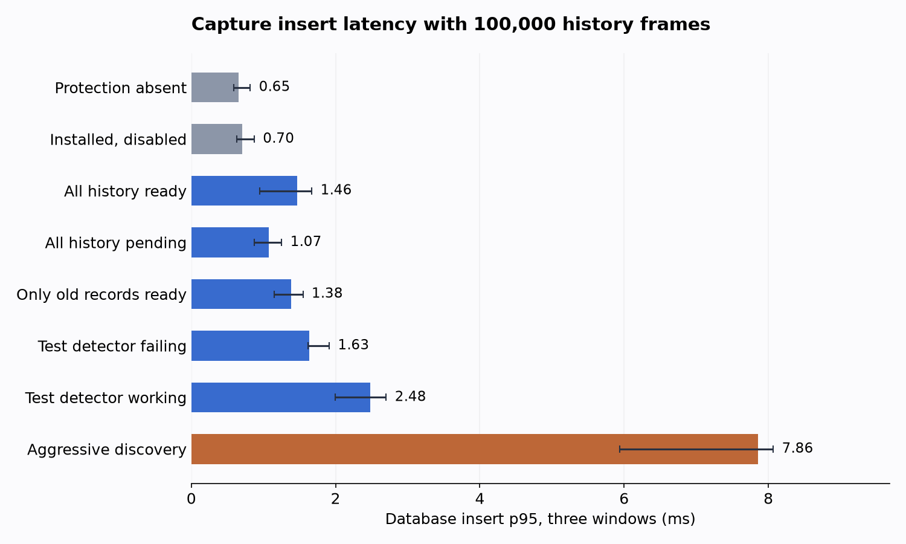
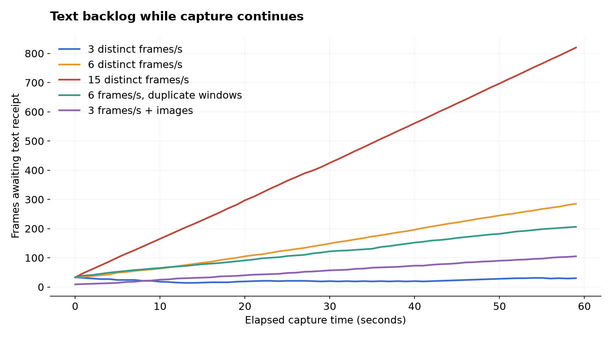

# PII gate benchmark results

Historical snapshot. See [the subsequent compatibility fixes and controlled measurements](MERGE-READINESS.md) and the PR body for current validation; the measurements and counts below describe their original revision.

Measured on October 14, 2026, on an Apple M5 Max, 18 CPU cores, 128 GiB RAM, macOS 26.6.2. Unmodified release profile (`opt-level=s`, LTO, one codegen unit), `onnx-cpu`. This is a high-end machine and CPU execution only. Our benchmark processes ran serially after compilation; the user’s normal desktop workloads were not stopped, so this is not dedicated-machine isolation. All inputs are synthetic; no production data or traffic figures are included.

The final serial run passed **41 scale cases and seven model/stress cases plus two six-frame-load repeats, and four policy-ID sensitivity cases**. It seeded 7,412,000 history frames across fresh databases and inserted 123,000 additional frames in the scale matrix. Test success means its assertions passed; it does not imply a drained backlog, zero overhead, accurate detection, or rollout readiness.

## Capture overhead

A timed capture operation inserts three distinct synthetic windows through the production OCR database batch path. It excludes screen acquisition, OCR computation and image encoding; it is not total desktop capture latency. Each case performs 1,000 such operations while a separate task reads the latest page every 10 ms. At 100,000 history frames, each row below is the median of three per-run quantiles. Ranges describe those three runs, not confidence intervals. The baseline comparison changes gate state on fresh databases; filesystem caches are not forcibly cold.

| 100k history state | Capture p95, ms | p95 range, ms | Capture p99, ms | CPU ms / three-window capture |
| --- | ---: | ---: | ---: | ---: |
| off | 0.651 | 0.589–0.817 | 1.229 | 0.610 |
| disabled | 0.702 | 0.634–0.872 | 1.606 | 0.615 |
| ready | 1.463 | 0.945–1.671 | 4.814 | 1.064 |
| pending | 1.070 | 0.877–1.253 | 3.232 | 0.859 |
| sparse | 1.380 | 1.153–1.547 | 4.644 | 1.776 |
| discovery | 7.855 | 5.942–8.068 | 9.970 | 5.043 |
| failure | 1.632 | 1.617–1.912 | 5.165 | 1.415 |
| worker | 2.480 | 1.991–2.702 | 5.680 | 2.858 |

Ready-state p95 increased by **0.812 ms**, from 0.651 to 1.463 ms (**2.25×**). This is a ratio of run-summary quantiles, not a per-operation slowdown distribution. CPU includes the concurrent reader and any worker/discovery work during capture. Discovery deliberately polls every 1 ms, which stresses writer contention beyond normal production cadence. Worker/failure cases use a synthetic detector to isolate gate behavior.



## Queue and Settings status reads

At 100k history frames, median of three run-level p95 values, 100 observations per function per run. These calls precede the timed capture/worker phase, so failure/worker rows have the same pending setup here and are not active retry-load measurements.

| State | Select pending page p95, ms | Queue status p95, ms |
| --- | ---: | ---: |
| disabled | 0.060 | 0.059 |
| ready | 0.227 | 0.683 |
| pending | 0.281 | 1.498 |
| sparse | 0.315 | 1.821 |

The status function caps counts rather than scanning an exact total. These database calls exclude HTTP and React rendering; they do not measure packaged Settings responsiveness.

## Retained storage and memory

These million-frame cases include setup, reads and 3,000 new captured frames. RSS is the process high-water mark; DB/WAL values are end-of-case retained lengths. They are not allocation deltas, cumulative writes or steady-state production storage forecasts.

| State | Peak RSS, MiB | DB, MiB | WAL, MiB |
| --- | ---: | ---: | ---: |
| off | 422.8 | 493.7 | 223.7 |
| ready | 500.8 | 665.0 | 323.2 |
| pending | 277.3 | 813.5 | 328.8 |
| sparse | 485.2 | 813.5 | 329.5 |
| discovery | 107.5 | 493.8 | 392.4 |

Ready/pending fixtures prepopulate both text and image receipts. They omit the completion-event stream and historical OCR-element receipts; actual full-pipeline storage adds those records and their indexes. Discovery starts without that full receipt backlog, so its smaller footprint cannot be read as equivalent memory efficiency. Pending state has additional queue/index storage. WAL sizes depend on checkpoint/reader timing.

## Policy identity length sensitivity

The primary matrix uses the eight-byte `bench:v1` identity. Production includes model/backend/label/column configuration in its identity, so the short fixture understates larger policy keys. These extra all-ready cases compare 8 and 512 bytes at each history size, with one process per cell, 30 read observations and 1,000 capture bursts. 512 bytes is a sensitivity probe, not every production configuration. No detector runs in these cases.

| History | Policy ID bytes | DB, MiB | WAL, MiB | Search p95, ms | Count p95, ms | Capture p95, ms | Peak RSS, MiB |
| ---: | ---: | ---: | ---: | ---: | ---: | ---: | ---: |
| 100,000 | 8 | 66.2 | 279.9 | 197.8 | 70.0 | 2.937 | 118.4 |
| 100,000 | 512 | 281.4 | 279.4 | 275.4 | 116.1 | 2.287 | 481.1 |
| 1,000,000 | 8 | 665.0 | 323.5 | 3080.7 | 1174.7 | 3.394 | 612.7 |
| 1,000,000 | 512 | 2812.3 | 322.5 | 17903.2 | 6644.0 | 5.212 | 894.9 |

With two receipts per frame and policy bytes in both the receipt table and covering index, the first-order storage increment is about `4 × N × Δidentity_bytes`, plus B-tree/page overhead. Actual publication also stores the policy in completion events, which these ready fixtures omit; the formula and measured footprints therefore understate full-pipeline policy duplication. Going from 8 to 512 bytes adds roughly 192 MiB per 100k frames before that overhead. A compact fixed-size policy key with the full contract stored once would avoid repeating this configuration per record; that schema improvement is not implemented here. Single-run latency differences cannot establish a stable speedup/slowdown, and these cells should not be pooled with the three-run matrix. [Raw identity samples](identity-results.jsonl).

## Read latency and remaining UX limits

The search fixture matches the marker in every history frame and returns at most 50 records through `DatabaseManager.search`. Sparse means only the oldest 50 frames have receipts. These are intentionally difficult shapes; they are not a measured customer query mix.

| History | State | Latest-page p95, ms | Broad FTS p95, ms | Exact count p95, ms |
| ---: | --- | ---: | ---: | ---: |
| 100,000 | off | 0.066 | 21.100 | 0.084 |
| 100,000 | ready | 0.133 | 101.274 | 38.085 |
| 100,000 | pending | 0.043 | 0.243 | 0.040 |
| 100,000 | sparse | 22.756 | 29.548 | 22.794 |
| 1,000,000 | off | 0.079 | 311.425 | 5.135 |
| 1,000,000 | ready | 0.287 | 1288.913 | 479.080 |
| 1,000,000 | pending | 0.199 | 0.627 | 0.102 |
| 1,000,000 | sparse | 519.973 | 530.870 | 414.134 |

100k rows summarize three runs with 100 observations per read type per run. Million-frame rows are **one run with 30 observations** per read type; their p99 would effectively describe the maximum, not a stable tail estimate.

The covering receipt index and policy-first empty guard keep wholly pending history fast. Broad ready searches, exact counts and sparse ready history still scale poorly. A fast capture path does not hide a one-second search or an apparently empty history. Keep the PR draft; optimize query admission around candidate/receipt selection before rollout, preserve visibility predicates, and rerun this matrix. The existing UI must continue distinguishing incomplete history from no matching data. For a latest page of k records and roughly uniform ready fraction p, filtering in capture order can inspect about k/p candidates; with ready records only at the old end, it can inspect the entire N-record history. The empty-history guard fixes p=0, but does not fix that sparse ordering case. Candidate selection must choose an efficient source/receipt order while preserving the same current-policy predicate.

## Real text models and backlog

Each run uses the installed v50 ONNX text model inside the production regex/cache pipeline, the default worker and shared CPU governor. The initial backlog is 30 frames (six for mixed). Each capture also produces OCR element records. Frame throughput therefore uses durable **frame receipts**; the aggregate worker counter includes other text surfaces and is reported separately in the raw results.

| Case | Scheduled frames/s | Actual capture duration, s | Frame receipts at capture end / total | Frame receipts at final stop / total | Text drain complete | Additional drain, s | Capture p95, ms | Process peak RSS, MiB |
| --- | ---: | ---: | --- | --- | --- | ---: | ---: | ---: |
| text-1 | 3 | 59.00 | 180 / 210 | 210 / 210 | True | 9.81 | 1.233 | 772.0 |
| text-2 | 6 | 59.50 | 103 / 390 | 259 / 390 | False | 120.00 | 57.268 | 776.7 |
| text-5 | 15 | 59.81 | 99 / 930 | 287 / 930 | False | 120.00 | 13.045 | 776.1 |
| text-duplicate-2 | 6 | 59.55 | 181 / 390 | 390 / 390 | True | 15.13 | 7.778 | 773.4 |
| mixed | 3 | 59.00 | 81 / 186 | 92 / 186 | False | 120.00 | 1.462 | 1339.8 |



The chart shows the first run per scenario; the six-frame repeats are tabulated separately below.

Captures are scheduled for 60 seconds using skipped missed ticks. Drain is bounded to 120 seconds. `processed_per_s` in raw data divides final frame receipts by the entire capture-plus-drain-and-shutdown runtime; it is **not** steady-state capacity. Use the backlog series and actual capture duration to assess whether the offered load stays ahead of processing. The real-model cost includes the existing detector pipeline and cannot all be attributed to the new release gate. Model-run capture latency is an absolute observation at the stated arrival schedule, not a paired model-on/model-off overhead percentage; the scale matrix uses a different, tight-loop capture schedule. Duplicate windows deliberately exercise cache reuse and must not be used as the distinct-content capacity estimate.

In the mixed case, text and 512×512 image workers share the default governor. Screenshots are deliberately mature, bypassing only fixture age waiting. Image copies/attachment are outside the timed capture call; whole-phase CPU includes that fixture work. Text drain completion never implies image completion.

Mixed final result: **145 images released, 41 image receipts still pending**; 179 text-surface receipts pending.

## Repeatability of the six-frame text load

The initial distinct-content run had a large capture tail, so it was repeated twice in fresh processes with the same parameters. Ordinary desktop activity remained uncontrolled. All three outcomes are retained; do not select only the fastest run.

| Run | Capture p95 / p99 / max, ms | Final pending frames | Text drained | Whole-phase CPU, % of one core |
| --- | --- | ---: | --- | ---: |
| text-2 | 57.27 / 91.06 / 98.80 | 131 | False | 28.3 |
| text-2-repeat-1 | 16.94 / 70.11 / 90.43 | 95 | False | 31.1 |
| text-2-repeat-2 | 3.01 / 8.24 / 38.67 | 79 | False | 30.0 |

[Repeat raw samples](repeat-results.jsonl). The excluded image fixture attempt and its timeout remain in [a separate record](excluded-fixture-run.jsonl); date-only timestamps prevented processing, so it is not evidence of model/worker capacity. An affected mixed attempt was cancelled and rerun with full timestamps.

## Model initialization

Fresh processes, existing model artifacts, no forced filesystem-cache eviction. These are constructor times and whole-process high-water RSS at that point, not download time, incremental model allocations or guaranteed cold-start latency. First image inference is reported separately below.

| Case | Model initialization, ms | Process peak RSS at initialization, MiB |
| --- | ---: | ---: |
| text-1 | 295.7 | 699.6 |
| text-2 | 374.9 | 700.3 |
| text-5 | 766.3 | 702.9 |
| text-duplicate-2 | 661.2 | 705.0 |
| image | 398.3 | 156.8 |
| mixed | 335.5 | 703.4 |

The mixed row records text-model initialization; the final mixed process peak includes both models. Large-field initialization is outside its individual inference intervals.

## Real image pipeline

RF-DETR v38, ONNX CPU, tiling enabled. First direct detection is separated from 30 repeated calls per resolution. Worker measurement publishes four copied images per resolution through actual replacement and receipt publication with the default governor. It includes worker cooldown; direct inference does not. The process and global governor persist between resolutions, with unthrottled direct detections before each worker phase. The four-image result therefore includes startup/prior-load effects and is not sustained isolated image capacity.

| Resolution | First detection, ms | Repeated detection p50 / p95 / max, ms | Four-image worker time, s | Worker images/s | Whole-process peak RSS, MiB |
| --- | ---: | --- | ---: | ---: | ---: |
| 512×512 | 470.7 | 385.0 / 521.8 / 542.7 | 6.66 | 0.600 | 717.4 |
| 1920×1080 | 2130.0 | 1594.4 / 2113.5 / 2263.1 | 78.05 | 0.051 | 727.9 |
| 3840×2160 | 1624.1 | 1931.8 / 2640.7 / 2697.5 | 73.58 | 0.054 | 737.8 |

Image RSS is a process high-water mark across successive resolutions, not isolated allocation per resolution. Synthetic detections and decodable output establish execution and publication, not precision/recall or semantic redaction quality.

## Large indivisible calls

One real production-pipeline inference per input size. Capture is offered every 50 ms concurrently; only capture spans overlapping the inference interval are retained. These are stress observations, not stable quantiles or governed long-run capacity.

| Input | Single inference, s | Overlapping capture observations | Capture p95 / max, ms | Process peak RSS, MiB |
| ---: | ---: | ---: | --- | ---: |
| 4,096 bytes | 2.321 | 47 | 18.054 / 21.935 | 770.7 |
| 65,536 bytes | 36.978 | 738 | 28.047 / 102.273 | 783.5 |
| 1,048,576 bytes | 569.292 | 11344 | 14.063 / 223.344 | 856.3 |

The 250 ms text slice target is cooperative: one inference cannot be preempted. Long calls can monopolize the shared background lane despite durable capture continuing. Chunking needs resumable state and atomic final publication; simply certifying a truncated field would weaken the gate.

## Capacity and resource math

For each modality, with arrival rate λ, governed processing rate μ and backlog B:

```text
B_next = max(0, B + (λ − μ) × Δt)
Catch-up time = B / (μ − λ), only when μ > λ
Outage recovery within R after outage D requires μ ≥ λ × (1 + D/R)
```

Treat text and image demand separately, then measure them together because they share resources. Isolated throughputs cannot be added. One minute of overload is evidence of growing backlog, not an estimate of daily capacity on every device.

The default governor targets 30% of one core for whole-process CPU, not 30% of this 18-core machine. Its ideal rest calculation is `work × (active − target)/(target − idle)`, clipped to configured limits. At one active core and zero idle load, one second of work needs about 2.33 seconds of rest. An indivisible call, unavailable samples, other capture work and the 60-second maximum cooldown prevent this from being a hard CPU ceiling. For example, a hypothetical fully busy one-core call lasting 600 seconds followed by the maximum 60-second rest still averages 600/660 = 90.9% of one core over that cycle, despite a 30% target. This is budget arithmetic, not a measured governed 1 MiB run. Resuming between model windows is necessary to enforce smaller work intervals. Process CPU includes fixture/read work and differs from system-wide CPU or energy use.

RSS is the process high-water mark including setup and model load. DB/WAL lengths in the raw results measure retained footprint, not bytes written or disk write amplification. No battery, energy, thermal or desktop animation measurements were taken.

## Correctness and scope

See [edge-case evidence](EDGE-CASES.md) for exact regression names and fault boundaries. Current local validation: 207 redaction unit tests, 21 privacy integration tests, two SQLite/hybrid HTTP E2E tests and 141 enterprise-sync tests passed. Six UI tests passed on the preceding unchanged UI revision. Manual benchmarks are additional and remain ignored in regular suites; no CI jobs were added.

The workload exposed future-timestamp scheduling and stale pooled-writer schema bugs, fixed before the main timings. A subsequent regression reproduced malformed-timestamp image queue starvation; its error-path-only fix was validated after the main timings. Main timing workloads use valid timestamps and are unaffected semantically, but were not retimed after that error-path change. It also exposed measurement mistakes: aggregate text-surface completions were not frame throughput, and capture comparisons needed equal reader work. Final raw evidence uses corrected counters and equal reader load; pilot data is excluded.

Physical disk/power faults, OOM, multi-hour thermal effects, lower-end hardware, accelerated providers, Windows/Linux models, packaged desktop E2E and detector recall remain unproven. Unsupported adapters and direct filesystem/database access remain outside this draft's guarantee. Model processing is required on covered paths; it does not mean every PII entity was found.

[Reproduction and methodology](README.md) · [Scale raw samples](scale-results.jsonl) · [Model raw samples](model-results.jsonl) · [Build and machine record](machine.json)
